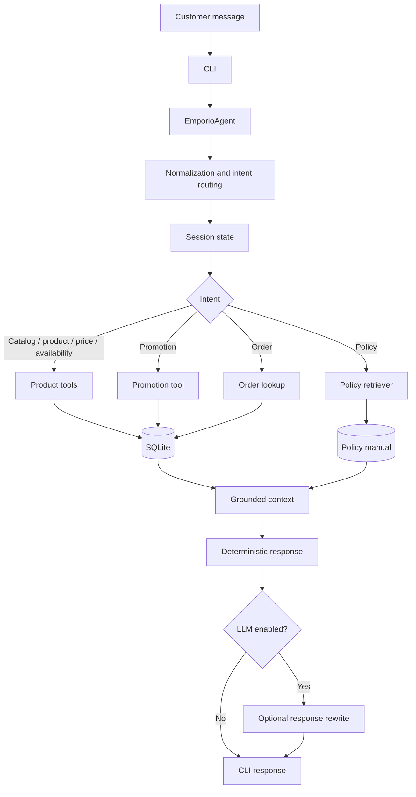

# Architecture

## 1. Purpose and scope

Empório AI Agent is a local prototype for customer service at a fictional music retailer. Its architecture is intentionally hybrid:

- explicit application-level intent routing;
- deterministic functions for structured business data;
- lexical retrieval over the supplied policy manual;
- process-local conversational state scoped by session identifier;
- optional LLM-assisted response rewriting.

The design keeps business facts outside the LLM. The supplied CSV files are a static demonstration snapshot, not a live operational integration.

## 2. Component view

## 3. Request lifecycle

1. The CLI reads a message and passes it to `EmporioAgent.respond(message, session_id)`.
2. The agent normalizes text for routing, including case and accent normalization.
3. Intent routing determines whether the message concerns products, categories, prices, availability, promotions, orders, policies, comparison, sorting, or general conversation.
4. The agent reads or updates state associated with the current session.
5. The relevant deterministic tool queries SQLite, or the policy retriever searches the manual.
6. The response layer formats the result and includes only facts supported by the retrieved context.
7. If LLM mode is enabled for a supported intent, the model may rewrite the grounded answer. The deterministic answer is the fallback baseline.

## 4. Data flow and boundaries

### Structured business data

The CSV files are loaded into SQLite by `database.initialize_database()`. The `tools` module exposes narrow functions for product search, categories, promotions, and order lookup. SQL values supplied by the user are passed as bound parameters.

### Policy knowledge

`policies.retrieve_policy()` reads `data/politicas.md`, splits it into Markdown sections, tokenizes the question and each section, and ranks sections by token overlap. This is a lightweight lexical retrieval method, not embedding-based semantic search.

### Session context

The agent maintains context by `session_id`. The context supports policy-topic selection, comparisons, sorting, and sequential product recommendations. Recommendation state includes the last catalog result set, category, maximum budget, explicit product preferences (for example, string type and brand), the current recommended product, and identifiers of products already recommended in that session. Short replies are interpreted as preference updates only while a recommendation refinement is pending.

Before producing another recommendation or a cheaper alternative, the agent refreshes the category query using the active budget, applies explicit preference filters against catalog descriptions and structured `specs`, and excludes previously recommended product IDs from alternative listings. The recommendation history is scoped to the in-memory session object; it is not shared across session IDs and is not durable across process restarts. Session context is not an authenticated identity.

### LLM boundary

The optional LLM is a response-language layer. It should not:
- execute SQL;
- decide the actual stock quantity or product price;
- invent promotion status or order status;
- override the policy manual;
- perform operational actions such as refunds or cancellations.

The `--no-llm` option provides a deterministic mode for repeatable local evaluation.

## 5. Module responsibilities

| Module | Responsibility |
|---|---|
| `cli.py` | Parse command-line options, initialize SQLite, run the interactive loop |
| `agent.py` | Normalize messages, route intents, maintain session state and recommendation preferences/history, orchestrate tools, format responses |
| `tools.py` | Execute deterministic, parameterized queries for catalog, promotions, and orders |
| `database.py` | Load CSV data into SQLite and provide query access |
| `policies.py` | Retrieve relevant policy-manual sections using lexical token overlap |
| `config.py` | Resolve project paths and environment configuration |
| `tests/test_agent.py` | Automated regression tests for agent behavior |

## 6. Key design decisions

### Explicit routing instead of LLM-only classification

The challenge requires predictable behavior over a bounded set of intents. Explicit routing makes the main flows inspectable and testable. Its trade-off is that new phrasings may require new patterns and regression tests.

### Deterministic tools for business data

Structured commercial facts are retrieved from SQLite through application functions. This makes outputs reproducible and limits hallucination risk. The trade-off is dependence on the freshness and quality of the supplied snapshot.

### Lexical retrieval for the policy manual

A lexical retriever is easy to run locally and introduces no embedding service or vector database dependency. Its limitations include weak semantic matching, sensitivity to vocabulary, and possible retrieval of adjacent or partially relevant sections.

### Session state for follow-up handling

Short follow-up messages are common in customer service. Session-scoped state enables continuity for policy topics, comparisons, and sorting. The current implementation is process-local; multi-process or persistent deployment would require a shared state store and explicit lifecycle/retention rules.

### Contextual recommendation refinement

Recommendation follow-ups use deterministic state transitions. After an initial recommendation, the agent may capture a short preference response (string type, supported brand, or maximum price). A subsequent request for another option re-queries the same category, applies the current filters to catalog fields, and excludes product IDs already recommended in that session. If no compatible product remains, the agent states that no match was found instead of relaxing filters silently.

The selection heuristic prioritizes products whose catalog description explicitly references beginners or students, then uses price as a tie-breaker. This is a transparent catalog-based heuristic, not a personalized ranking model or an independent product-quality assessment.

### Optional LLM rewriting

The optional model can improve conversational fluency, but it is not the source of truth. The deterministic path remains available and should be used as the baseline during debugging and evaluation.

## 7. Security and privacy considerations

- Parameterized SQL is used for user-supplied query values.
- Demonstration order lookup requires both an order identifier and a customer-name check; this is not production-grade identity verification.
- Session identifiers are context boundaries, not authentication credentials.
- Runtime history may contain personal messages and should be protected and retained only as necessary.
- The supplied customer CSV must be reviewed before public distribution. Remove or anonymize real personal data.
- Production use requires authentication, authorization, auditability, secrets management, retention controls, monitoring, and a legal/privacy review appropriate to LGPD.

## 8. Known limitations

- Static CSV snapshot; no live inventory, order, payment, or shipping integration.
- Rule-based intent routing; unrecognized phrasings may fall through to a generic response.
- Lexical policy retrieval; no embeddings, reranking, or calibrated relevance threshold.
- Session context and recommendation history are volatile and process-local.
- Preference extraction is rule-based and supports a bounded set of explicit attributes; it is not a general natural-language preference parser.
- Customer-name matching is not sufficient authentication for real customer data.
- The prototype does not execute refunds, cancellations, reservations, or order changes.
- No production SLA, load test, latency target, or model-quality benchmark is claimed.

## 9. Evaluation strategy

The V3.3.4 suite includes 73 automated tests in the recorded validation run. For further development, evaluate the system at multiple levels:

1. **Intent routing:** precision/recall by intent and confusion matrix for ambiguous short messages.
2. **Tool correctness:** verify SQL filters, product matching, stock handling, and promotion eligibility.
3. **Groundedness:** ensure every commercial claim is supported by a tool result or manual passage.
4. **Retrieval quality:** measure whether the expected policy section is retrieved and whether irrelevant sections are avoided.
5. **Dialogue state:** test follow-up handling and isolation across session identifiers.
6. **Robustness:** test misspellings, accent variations, prompt injection attempts, empty results, and tool failures.
7. **Operational behavior:** measure latency, error rates, and behavior under concurrent sessions before any deployment.

No metric beyond the recorded automated test result should be claimed until the corresponding evaluation is implemented and executed.

## New catalog search precedence (V3.3.4)

An explicit catalog-search phrase is evaluated before pending recommendation
refinement. When detected, the agent clears the active search context
(`last_products`, `catalog_products`, category, budget, preference filters,
recommended product, recommendation IDs, and pending action) and routes the
message normally. The product tool then performs a fresh query. Session identity
and persisted conversation history are not cleared. Short attribute replies
such as a brand or string type remain preference refinements when no explicit
new-search phrase is present. This is a deterministic phrase-based rule, not a
general natural-language classifier; new phrasings should be covered by tests.
