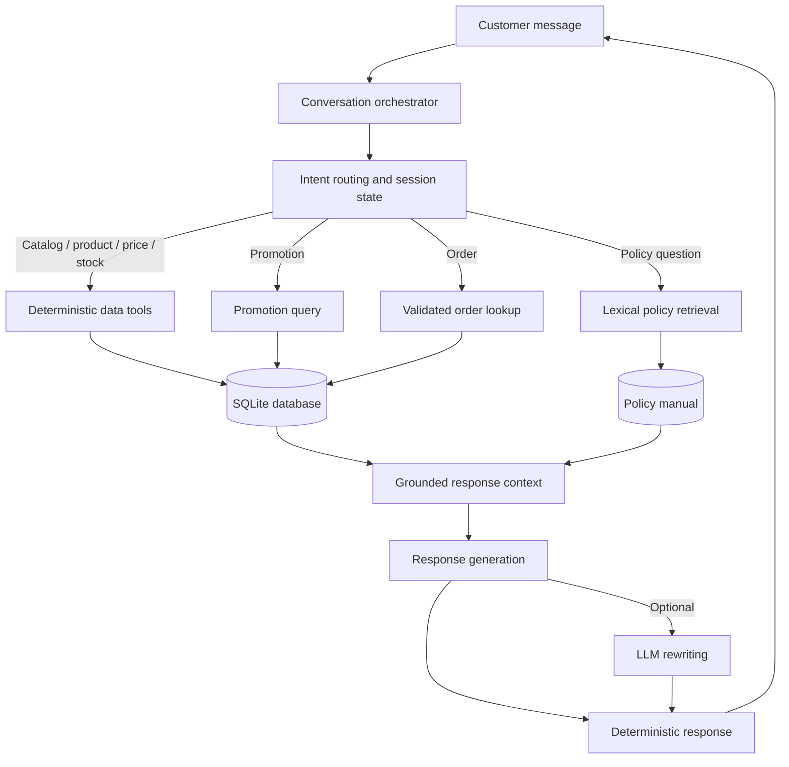

# Empório AI Agent

**A Python-based conversational customer service agent for music retail.**

The Empório AI Agent is a prototype developed for the Artefact AI Engineer technical challenge. It supports customer conversations in Brazilian Portuguese and combines explicit intent routing, deterministic data tools, lexical policy retrieval, session-level conversational state, and optional LLM-assisted response rewriting.

> **Prototype and data notice:** the supplied CSV files are demonstration data. This project does not connect to a live ERP, CRM, payment gateway, shipping provider, or inventory service. Product prices, stock quantities, promotions, and order details are only as current as the provided dataset.

## Project status

| Item | Status |
|---|---|
| Current release | `3.2.1` |
| Python | `3.10+` (tested in the development environment with Python 3.12) |
| Interface | Command-line interface (CLI) |
| Structured data | CSV imported into SQLite |
| Policy retrieval | Lightweight lexical retrieval (RAG-style) |
| LLM | Optional |
| Automated tests | 41 passing in the validated V3.2 codebase |

**V3.2.1 is a documentation and release-metadata update.** It does not change the conversational behavior validated in V3.2. The package version was updated from `3.2.0` to `3.2.1`; the existing 41-test suite was rerun against this release package.

## Key capabilities

- **Product discovery:** search the demonstration catalog by product, brand, category, and maximum price.
- **Availability lookup:** display the stock quantity recorded in the supplied dataset, without implying real-time inventory access.
- **Contextual comparison:** compare products found during the previous catalog query in the same session, using fields available in the dataset.
- **Contextual sorting:** sort the previous result set by lowest price, highest price, or highest recorded stock.
- **Promotions:** retrieve promotions flagged as active, subject to the product status and stock data available in the snapshot.
- **Order lookup:** require an order identifier and customer-name validation for the demonstration lookup.
- **Policy questions:** retrieve relevant sections from the store policy manual, including payment, returns, shipping, warranty, store information, customer service, and privacy.
- **Session context:** retain conversational state within a session and keep different session identifiers isolated.
- **Out-of-scope handling:** explain that the store sells musical instruments, not accessories, and redirect unrelated requests.
- **Optional LLM rewriting:** use an LLM to improve wording while keeping the deterministic response and retrieved context as the factual basis.

## Architecture

The system follows a deliberately constrained hybrid design. The LLM is not the source of truth for prices, inventory, promotions, orders, or policy rules.



### Request lifecycle

1. The CLI receives a customer message and associates it with a `session_id`.
2. The agent normalizes the message and identifies the intent using explicit routing rules.
3. The session state is consulted when the message is a follow-up, such as a policy topic, a comparison request, or a sorting instruction.
4. The agent invokes the relevant deterministic function or policy retriever.
5. The response is composed from the returned data and available policy text.
6. If LLM mode is enabled, the model may rewrite the grounded response. The deterministic mode remains available with `--no-llm`.

For implementation details and module responsibilities, see [ARCHITECTURE.md](ARCHITECTURE.md).

## Technology stack

- **Python 3.10+**
- **SQLite** for local structured-data queries
- **Pandas** for CSV ingestion
- **python-dotenv** for environment configuration
- **OpenAI Python SDK** for optional LLM rewriting
- **Pytest** for automated tests

The policy retriever is lexical: it splits the manual into sections, normalizes tokens, scores overlap with the query, and returns the highest-scoring sections. It does not use embeddings, a vector database, or a reranker.

## Repository structure

```text
emporio_ai_agent/
├── data/
│   ├── categories.csv
│   ├── customers.csv
│   ├── order_items.csv
│   ├── orders.csv
│   ├── products.csv
│   ├── promotions.csv
│   └── politicas.md
├── examples/
│   ├── 01_catalogo_violao.md
│   ├── 02_preco_produto.md
│   ├── 03_pedido_rastreamento.md
│   └── 04_devolucao_e_escopo.md
├── history/                 # Local runtime history; not committed
├── src/emporio_agent/
│   ├── agent.py             # Routing, dialogue state, response orchestration
│   ├── cli.py               # Command-line interface
│   ├── config.py            # Paths and environment configuration
│   ├── database.py          # SQLite initialization and query access
│   ├── policies.py          # Lexical policy retrieval
│   └── tools.py             # Deterministic business-data tools
├── tests/
│   └── test_agent.py
├── .env.example
├── .gitignore
├── pyproject.toml
├── requirements.txt
├── ARCHITECTURE.md
├── CHANGELOG.md
└── README.md
```

## Quick start

### Requirements

- Python 3.10 or newer.
- Git (optional, for cloning the repository).
- VS Code or another Python-compatible editor (optional).

### Windows PowerShell

From the project root:

```powershell
py -3.12 -m venv .venv
.\.venv\Scripts\Activate.ps1
python -m pip install --upgrade pip
pip install -r requirements.txt
pip install -e .
Copy-Item .env.example .env
```

If PowerShell blocks virtual-environment activation, allow it for the current terminal process:

```powershell
Set-ExecutionPolicy -Scope Process -ExecutionPolicy Bypass
.\.venv\Scripts\Activate.ps1
```

### macOS / Linux

```bash
python3 -m venv .venv
source .venv/bin/activate
python -m pip install --upgrade pip
pip install -r requirements.txt
pip install -e .
cp .env.example .env
```

### Run without an LLM

The deterministic mode does not require an API key:

```bash
python -m emporio_agent --no-llm
```

Rebuild the local SQLite database from the CSV files:

```bash
python -m emporio_agent --rebuild-db --no-llm
```

### Optional OpenAI integration

Set the following values in `.env`:

```dotenv
OPENAI_API_KEY=your_api_key
OPENAI_MODEL=gpt-4o-mini
```

Then run:

```bash
python -m emporio_agent
```

Never commit `.env` or expose API keys. The LLM integration is optional; deterministic mode is the reproducible baseline for local evaluation.

## Example conversations

The agent communicates in Brazilian Portuguese. The repository includes longer examples under [`examples/`](examples/).

A short catalog and comparison flow:

```text
Você: Quero ver guitarras
Empório da Música: [Lists matching products from the demonstration catalog]

Você: comparar modelos
Empório da Música: [Compares the products found in the current session]

Você: menor preço
Empório da Música: [Sorts the previous result set by price]
```

A policy follow-up flow:

```text
Você: explicar políticas da loja
Empório da Música: [Lists available policy topics]

Você: promoções
Empório da Música: [Retrieves the relevant section from the policy manual]
```

These are representative interaction patterns. Exact wording and returned products depend on the supplied data.

## Evaluation and tests

Run the automated suite from the project root:

```bash
python -m pytest -q
```

**Validation record for release 3.2.1:** 41 tests passed when the consolidated release archive was tested. The tests cover the existing agent behaviors and regression cases for routing, policy follow-ups, product lookup, comparison, sorting, and session context.

The test count is not a substitute for a quality metric. No claim of a particular code-coverage percentage, production accuracy, latency, or LLM evaluation score is made.

### Manual smoke-test sequence

```text
Adriano
explicar políticas da loja
promoções
atendimento
sobre a loja
comparar modelos
catálogo
comparar modelos
guitarras
comparar modelos
menor preço
maior estoque
sair
```

The project was also manually exercised in Windows PowerShell during development. Before submitting a new environment or changing dependencies, rerun both the automated suite and the manual smoke test.

## Engineering decisions

### Deterministic tools for business facts

Product, stock, promotion, and order data are retrieved through application functions and parameterized SQLite queries. The LLM is not allowed to generate arbitrary SQL or invent transactional facts. This reduces the risk of unsupported commercial claims and makes core behavior testable without an API call.

### Explicit intent routing and session state

The agent uses explicit routing rules and session-level state to support follow-up messages. This is intentionally simpler and more inspectable than delegating every decision to an LLM. It also means that unanticipated phrasings may require additional rules and regression tests.

### Lexical policy retrieval

The policy retriever uses token overlap against sections of the provided manual. This keeps the prototype lightweight and easy to run locally. It may retrieve adjacent or partially relevant sections, so retrieval quality should be evaluated before using the approach with a larger policy corpus.

### Optional LLM response rewriting

The LLM is an optional language layer, not the authority for business data. The deterministic mode is available for repeatable tests and environments without credentials.

## Release history and known fixes

The project was iteratively validated through V3.0, V3.1, and V3.2. The most important observed issues and corrections are recorded in [CHANGELOG.md](CHANGELOG.md).

Examples include:
- short commands such as “comparar” being mistaken for customer names;
- policy topics such as “promoções” and “atendimento” being treated as names instead of follow-up answers;
- pending comparison requests losing context when the customer first selected a category;
- brand searches returning results that did not match the requested brand;
- sorting commands not consistently using the previous result set.

V3.2 addressed these observed regression cases. V3.2.1 changes documentation and package metadata only; it does not introduce new conversational behavior.

## Security, privacy, and data handling

- SQL statements use bound parameters for user-provided search values.
- Order lookup requires both an order identifier and a customer-name check in this demonstration.
- General catalog responses should not disclose customer contact details or unrelated orders.
- Runtime history may contain user messages. Keep it local, restrict access, and define retention before any real deployment.
- `.env`, local databases, caches, and runtime history are excluded from version control by the project configuration.
- **Review the CSV contents before making the repository public.** The challenge dataset includes customer-related fields. Even if data is described as fictitious, verify that the files contain no real personal data and that publication is permitted. Remove or anonymize sensitive records where necessary.
- This prototype does not execute refunds, cancellations, reservations, order changes, or other operational actions.
- A production deployment would require an appropriate identity and access-control model, data-retention policy, security review, monitoring, and LGPD assessment.

## Limitations and future work

- **Rule-based routing:** add evaluated examples for new intents and ambiguous language; consider semantic classification only with measurable acceptance criteria.
- **Lexical retrieval:** introduce relevance thresholds, retrieval evaluation, and optionally embeddings or reranking if the policy corpus grows.
- **Static dataset:** integrate with authorized production APIs only if the challenge scope and permissions allow it.
- **Identity verification:** replace name matching with a secure, channel-appropriate authentication flow before exposing real order data.
- **Session persistence:** current conversational state is process-local; persistence requires explicit retention and access-control decisions.
- **Observability:** add structured logs, latency measurements, error tracking, and conversation-level evaluation.
- **Human handoff:** integrate a support queue or CRM if operational escalation becomes part of the scope.

## Development transparency

ChatGPT was used as a coding assistant to support challenge interpretation, architecture discussion, implementation, debugging, test design, and documentation. The project author remains responsible for reviewing, understanding, and being able to explain the code and engineering decisions.

## License

No open-source license is currently specified. Unless a license is added by the project owner, the repository should not be assumed to grant broad reuse or redistribution rights. Confirm the challenge terms before publishing or reusing supplied materials.

---

**Current release:** `3.2.1`  
**Project type:** technical-challenge prototype  
**Primary language:** Python  
**Conversation language:** Brazilian Portuguese
